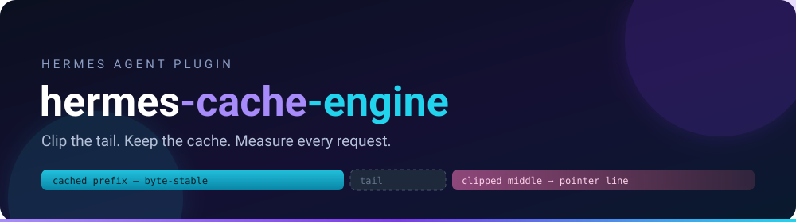
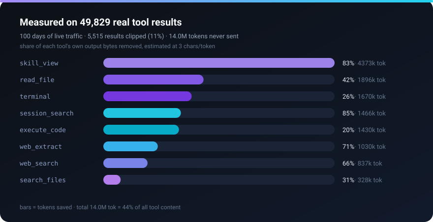
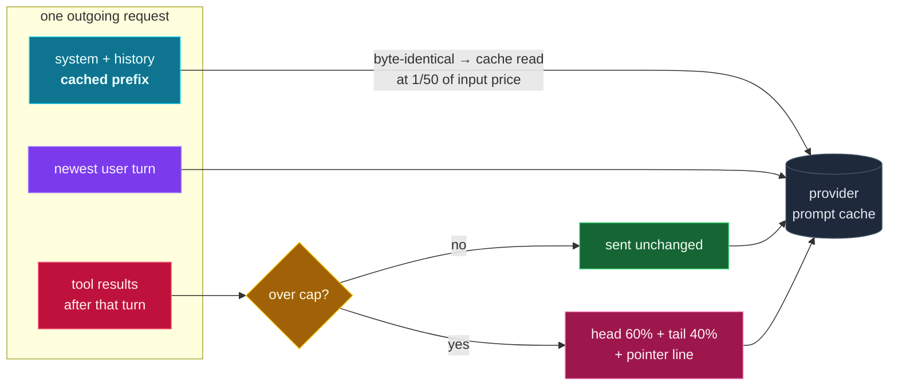

<div align="center">



<br>


**A Hermes Agent plugin that stops oversized tool results from entering context — without breaking the provider prompt cache.**

Measure first · clip only the mutable tail · never rewrite the cached prefix

</div>

---

## What it actually does

One middleware on Hermes' `llm_request` hook, three rules:

| Rule | Why it exists |
|---|---|
| 🔒 **Never touch the cached prefix** | Everything before the newest user message is byte-frozen. Rewriting history mid-conversation invalidates the provider cache from that point to the end of the context. |
| ✂️ **Clip oversized tool results** | Keep head **60%** + tail **40%**, drop the middle, leave a pointer line with a content fingerprint and the exact number of omitted tokens. Head *and* tail, because exit codes and stack traces live at the edges. |
| 📊 **Report every request** | One JSONL line per call: how many results were clipped, how many tokens were saved. `mode: report` measures and changes nothing. |

No dependencies. No core patches. Stdlib only, 13 tests.

---

## Measured, not promised



Real deployment, **100 days** of live traffic (34,877 API calls, 917 sessions, DeepSeek V4.1 Flash via OpenCode Go), replayed through the shipped defaults:

| | Value |
|---|---|
| Tool results analysed | **49,829** |
| Tool content | **95.4M chars** ≈ 31.8M tokens |
| Results over their cap | 5,515 (**11%**) |
| **Tokens never sent** | **14.0M — 44% of all tool content** |
| Share of fresh input tokens | 4.3% |
| Cached-prefix messages rewritten | **0 of 85,630** |
| Middleware overhead | **0.56 µs** median per result |

| tool | calls | output | saved | share of that tool's output |
|---|---|---|---|---|
| `skill_view` | 932 | 15.8M | 4.4M | 83% |
| `read_file` | 3,537 | 13.6M | 1.9M | 42% |
| `terminal` | 16,988 | 19.5M | 1.7M | 26% |
| `session_search` | 320 | 5.2M | 1.5M | 85% |
| `execute_code` | 18,256 | 21.3M | 1.4M | 20% |
| `web_extract` | 502 | 4.3M | 1.0M | 71% |
| `web_search` | 554 | 3.8M | 837k | 66% |
| `search_files` | 1,776 | 3.2M | 328k | 31% |

### What that is worth

Same 100 days, billed at DeepSeek V4.1 Flash list prices ($0.30 fresh input / $0.006 cache read / $1.20 output per million):

| bucket | tokens | cost | share |
|---|---|---|---|
| Fresh input (cache miss) | 330.0M | **$99.00** | **62.5%** |
| Output | 29.0M | $34.75 | 22.0% |
| Cache read (92.5% hit rate) | 4,090.6M | $24.54 | 15.5% |

The 14.0M tokens this plugin kept out of context are fresh-input tokens: **$4.21 saved** on this deployment. That number is small because DeepSeek input is cheap — the same 14.0M tokens cost **$35** at a $2.50/M input price, and the plugin is provider-agnostic.

Two honest limits, stated up front:

- **It does not touch output tokens.** That is the model's own writing; out of scope.
- **It saves repetition and volume, not work.** A result that must be read in full still costs what it costs — the cap is a budget, not a blindfold.

### Reading the cache correctly

The instinct "send less of the cached content" is backwards. A cache **miss** costs **50×** a cache read ($0.30 vs $0.006 per million). On this deployment cache reads are 92.5% of all input tokens and only 15.5% of the bill. Anything that rewrites history — mid-conversation compaction, "trim old messages", reordering — buys a few kilobytes and destroys the prefix that made the cheap 92.5% possible.

That is why the budget here is spent on the **tail only**, on the tokens that were going to be paid for at full price anyway.

---

## How it works



The clipper keeps the first 60% and the last 40% of the allowed budget and replaces the middle with a single line:

```
… [38,412 chars / ≈12,804 tok omitted · sha256:9f2ac41b77de] …
```

Defaults: 1,200 tokens per result, 6,000 hard ceiling, and tighter caps (900) for the tools that are statistically the biggest: `web_extract`, `skill_view`, `session_search`, `memory_recall`.

---

## Install

```bash
git clone https://github.com/Hadi77io/hermes-cache-engine.git \
  ~/.hermes/plugins/hermes-cache-engine
```

Enable it in `~/.hermes/config.yaml`:

```yaml
plugins:
  enabled:
    - hermes-cache-engine

cache_engine:
  mode: report            # report = measure only (safe) | enforce = clip for real
  default_cap: 1200
  hard_cap: 6000
  head_ratio: 0.6
  chars_per_token: 3.0
  per_tool:
    web_extract: 900
    skill_view: 900
    session_search: 900
    memory_recall: 900
    read_file: 2000
```

Restart the gateway so the plugin loads. Env overrides for quick experiments: `HERMES_CACHE_ENGINE_MODE=enforce`, `HERMES_CACHE_ENGINE_DEFAULT_CAP=800`.

### Start in report mode

`report` runs the real clipper over your real traffic and writes what it *would* have saved. Nothing is modified. After a day:

```bash
tail -5 ~/.hermes/cache-engine/stats.jsonl
python -c "from hermes_cache_engine.engine import CacheEngine; from hermes_cache_engine.config import load_settings; print(CacheEngine(load_settings()).total_saved())"
```

Flip to `enforce` when your own numbers justify it. Clipped results stay visible in the session history — only the outgoing request is trimmed, never the stored transcript.

---

## Reproduce these numbers

```bash
make bench            # 7 days from ~/state.db
python3 scripts/cee_bench.py --db /path/to/state.db --days 100 --json > docs/measured-100d.json
python3 scripts/make_assets.py docs/measured-100d.json   # regenerates the chart above
```

The benchmark reads Hermes' `state.db` read-only, replays every real tool result through the clipper, then replays whole conversations in `enforce` mode and asserts the prefix is byte-identical. It prints the table, the invariance check and the middleware overhead.

**Tokenizer calibration.** `chars_per_token: 3.0` is deliberately conservative. Counting real prompt tokens through the provider on a sample of this corpus gives **3.36 chars/token** (weighted across the top six tools; range 2.7 for `session_search` output to 4.6 for `web_extract` prose, Arabic sits at 3.25). Lower ratio = more estimated tokens = *smaller* claimed savings, so the quoted 14.0M errs on the safe side.

---

## Design notes

- **Middleware contract, verified.** The callback returns `{"request": {...}}`; Hermes ignores every other return shape silently. `tests/test_engine.py::test_enforce_returns_middleware_contract` exists precisely to keep that bug from coming back.
- **Copy-on-write.** The incoming request object is never mutated — the plugin builds a new message list and shares the prefix objects, so a caller holding the original payload sees it unchanged.
- **Tool names are recovered from `tool_call_id`** by scanning the requesting assistant turn, so caps work even when the wire format omits `name`.
- **Clamping is bounded:** `cap = min(per_tool[tool] or default_cap, hard_cap)`, never below 64 tokens.
- **Stats never break a request.** Every write is wrapped; the log is append-only JSONL.
- **Non-chat payloads are ignored** (`request["messages"]` only) rather than guessed at.

### Limits

- Chat Completions shape only. Responses-API payloads (`input`) pass through untouched.
- The pointer line carries a fingerprint but no retriever yet — v0.2 adds `fetch_context(sha, start, end)`.
- Token counts are estimates, not tokenizer calls; per provider they can drift ~10%.
- Caps are a judgement call. 900 tokens is generous for a page of prose and tight for a stack trace; tune `per_tool` against your own `stats.jsonl`.

---

## Roadmap

- [x] **v0.1** — tail-only clipping, per-tool caps, JSONL savings report
- [x] **v0.2** — verified middleware contract, copy-on-write requests, reproducible benchmark, prefix-invariance test
- [ ] **v0.3** — `fetch_context(fingerprint, start, end)` so clipped content stays reachable on demand
- [ ] **v0.4** — delta reads: re-reading a file returns a unified diff plus a fingerprint, not the whole file
- [ ] **v0.5** — budget allocator: fixed shares for system prompt / tool schemas / history / new content

---

<div dir="rtl">

## العربية

**بلغن لهيرمس يقلّل ما يدخل السياق، بلا كسر كاش المزوّد.**

- **القاعدة الذهبية:** لا يُعدَّل أي محتوى قبل آخر رسالة مستخدم. تعديل وسط التاريخ يمسح كاش المزوّد من نقطة التعديل لآخره، والـcache miss أغلى **50 مرة** من قراءة الكاش.
- **التقليم:** رأس 60% + ذيل 40%، مع سطر مؤشر يحوي بصمة المحتوى وعدد التوكنات المحذوفة.
- **الوضع الافتراضي `report`:** يقيس كم توكن كان سيوفر — بلا أي تغيير في السلوك.

**قياس حقيقي (100 يوم، 34,877 نداء، 917 جلسة):**

- 49,829 نتيجة أداة → **14.0 مليون توكن لم تُرسَل** = **44% من محتوى الأدوات**.
- 11% فقط من النتائج تجاوزت السقف — وهي التي تحمل معظم الحجم.
- **0 من 85,630** رسالة في البادئة المخزّنة تغيّرت (فحص إعادة تشغيل كامل).
- الكلفة الموفَّرة على أسعار DeepSeek: 4.21$ — رقم صغير لأن الإدخال رخيص عندهم؛ نفس الـ14 مليون توكن تساوي **35$** بسعر 2.50$/مليون.
- نسبة إصابة الكاش على هذا التشغيل 92.5%، وهي 15.5% فقط من الفاتورة — لذلك الهدف تقليل الإدخال الجديد، لا تقليل الكاش.

</div>

---

<div align="center">

**MIT © 2026 Hadi Aljurdi** · built and measured on a live Hermes deployment

</div>
